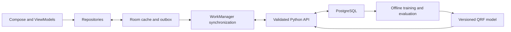

# NganyaFlow

**An Android research project for clearer matatu waiting-time information.**

NganyaFlow will help riders choose a stage and direction, inspect routes, see qualified waiting-time estimates, and optionally report boarding. Enumerators will collect reference vehicle observations; crew will inspect aggregated activity with explicit limitations.

## Project status

This repository is at the **design and research-planning stage**. It contains documentation, a concept note and design assets. There is no runnable Android app, API, collected research dataset, trained model or measured prediction accuracy yet. UI values are illustrative, not live transport information.

The proposed pilot covers **one corridor and three field-verified stages**. Thika Road locations and Route A/Route B labels in the prototype illustrate flow; they are not a verified route catalogue.

## Design and concept note

- [Material 3 redesign in Figma](https://www.figma.com/design/8gGZPr44bkjNq1zWNM4YYH?node-id=5-705)
- [Rider prototype](https://www.figma.com/proto/8gGZPr44bkjNq1zWNM4YYH?node-id=5-636)
- [Original mobile design](https://www.figma.com/design/fahMsqNcPzCHtFN8QmtSoj)
- Concept note: [Markdown](docs/concept-note.md), [Word](docs/concept-note.docx), [PDF](docs/concept-note.pdf). The main note is two pages; references follow separately.

The redesign is in a separate editable file because the original was read-only to the connected account. It retains blue branding and Roboto, introduces semantic Material colors and separates optional location from research consent. See [design decisions and verification status](docs/design-system.md).

## Documentation

| Guide | Contents |
| --- | --- |
| [Index](docs/README.md) | Reading paths and source of truth |
| [Product and flows](docs/product.md) | Roles, scope, journeys and states |
| [Design system](docs/design-system.md) | Color, typography, components and accessibility |
| [Architecture](docs/architecture.md) | Android, API, storage and synchronization |
| [AI methodology](docs/ai-methodology.md) | Model, labels, leakage prevention and evaluation |
| [Data dictionary](docs/data-dictionary.md) | Records, identifiers and quality rules |
| [Privacy and research](docs/privacy-and-research.md) | Consent, minimization, access and deletion |
| [Development roadmap](docs/development.md) | Milestones and acceptance checks |
| [References](docs/references.md) | Verified sources and course-note provenance |

Documentation lives in `docs/` so it is versioned and reviewed with code. A separate GitHub Wiki would duplicate the source of truth at this stage.

## Proposed technical approach



- **Android:** Kotlin, Compose, Material 3, ViewModel, Room, DataStore and WorkManager. Dependency versions and minimum Android version will be fixed with the first app scaffold.
- **AI:** Quantile Regression Forest prediction of median next-vehicle wait and candidate 10th/90th percentile bounds. It must beat historical baselines on held-out observations before serving estimates.
- **Evidence:** field observations establish actual vehicle events. Sparse rider reports are not automatically vehicle counts or total demand.
- **Recovery:** manual stage selection, durable local saves, distinct queued/synced/failed states and suppression of expired estimates.

## Explore the repository

```bash
git clone https://github.com/eyesonnesta/NganyaFlow.git
cd NganyaFlow
```

Open this README, `docs/README.md`, or the linked prototype. There are **no build or launch commands yet** because no app module or backend has been implemented. Setup instructions belong with the first working scaffold.

## Contributing

Read [CONTRIBUTING.md](CONTRIBUTING.md). Use a branch and pull request describing the problem, changed behavior and validation. Keep design/data contracts aligned with implementation. Never commit raw research data, access codes, credentials or precise location traces.

## Licence

Repository code and documentation use the [MIT licence](LICENSE), subject to [third-party notices](THIRD_PARTY_NOTICES.md). External design assets and datasets retain their own terms.
