# NganyaFlow Artificial Intelligence Foundation and Validation

**Units:** Artificial Intelligence and Mobile Application Development  
**Validation date:** 27 October 2026, Africa/Nairobi  
**Study:** Supervised prediction of residual waiting time using Quantile Regression Forests  
**Evidence status:** Synthetic validation at real Nairobi CBD place names

## 1. Executive finding

NganyaFlow now has a functioning, inspectable machine-learning pipeline: authenticated dataset import, session validation, training, chronological evaluation, diagnostic controls, candidate review, explicit activation, and prediction with abstention rules. The experiment was initiated through the admin panel, rather than substituting a prewritten set of scores for training.

The validation bundle contains **1,049 simulated vehicle arrivals**, **84 completed sessions**, and **14 dates** at Kencom, Odeon, and the Railways area at Nairobi Central Station. Training used 5–15 October 2026; testing used the later complete dates 16–18 October. The resulting forest achieved **0.939 minutes MAE**, versus **2.211** for a historical-median baseline and **1.018** for a last-headway baseline. Its nominal 80% interval covered **80.06%** of held-out query targets.

These results demonstrate a genuine fitted statistical model and a working research workflow **within this simulation**. They do not establish operational accuracy in Nairobi. The simulated service, its arrival times, and its demand-related parameters are not measured matatu operations. Real field evaluation remains necessary.

### Reading routes

- For theory and a viva: Sections 2–6 and 12.
- For the experiment and its evidence: Sections 7–11.
- For implementation and reproduction: Sections 13–15.
- For a presentation: use [the presentation outline](presentation-outline.md), with the figures and screenshots linked below.
- For machine-readable evidence: [evaluation JSON](evidence/evaluation.json) and [held-out predictions CSV](evidence/held-out-predictions.csv).

## 2. Problem definition and intelligent behaviour

A commuter needs information about the next vehicle at a selected stage, route, and direction. A route map answers where a service operates; it does not supply observations of its next arrival. NganyaFlow estimates a future quantity from recorded events and communicates uncertainty when evidence supports doing so.

The current learning task is:

> Given the selected stage, route, direction, local time, time elapsed since the latest arrival, and preceding headway, estimate the distribution of minutes until the next observed vehicle arrival.

The target is **arrival wait**, not guaranteed boarding time, seat availability, total journey duration, or traffic congestion. A full vehicle may arrive without allowing a passenger to board. Occupancy exists in the record schema but was `unknown` in this dataset and is not a model feature.

The system combines a learned estimator with deterministic safeguards. The forest provides numerical predictions. Ordinary application rules validate records, reject conflicts, enforce evidence freshness, and decide when to suppress an estimate. These safeguards are not learned neural reasoning or a complete expert-system inference engine.

From an intelligent-agent perspective, recorded arrivals are observations, a wait distribution is an inferred state, and showing or withholding an estimate is an output decision. The current application does not autonomously dispatch vehicles. Riders, enumerators, and crew are human product roles, not implemented autonomous AI agents. A broader agent-based framing is useful conceptually but should not be presented as an additional deployed model. [1]

## 3. Where this work sits within AI

AI branches overlap; there is no single exhaustive partition. Learning paradigms, model families, problem domains, and reasoning methods should not be treated as interchangeable categories. The following map distinguishes implementation from possible extensions. [1]

| Area | Main mechanism and typical application | NganyaFlow status |
|---|---|---|
| Supervised machine learning | Learn from labelled examples; predict a value or class | **Implemented:** labelled residual-wait regression |
| Ensemble learning | Combine multiple estimators | **Implemented:** a forest of 100 regression trees; a model family within ML |
| Statistical uncertainty estimation | Estimate conditional distributions or quantiles | **Implemented:** median and 10th/90th percentiles |
| Rule-based reasoning | Apply explicit conditions or domain rules | **Limited use:** validation and abstention rules; no general expert-system engine |
| Unsupervised learning | Discover structure without target labels | Not implemented; could explore stage or demand clusters |
| Semi-supervised learning | Combine labelled and unlabelled examples | Not implemented; would require a justified treatment of unreliable reports |
| Reinforcement learning | Learn a policy from rewards and interaction | Not implemented; future hold/depart advice would need a simulator and safety constraints |
| Deep learning | Learn representations with multilayer networks | Not implemented; a neural network is not required for this tabular pilot |
| Natural language processing | Interpret or generate language | Not implemented; future route queries could use English, Kiswahili, or Sheng |
| Computer vision | Infer information from images or video | Not implemented; camera-based occupancy would introduce new data and privacy requirements |
| Search and planning | Explore action sequences or paths under constraints | Not implemented; future route or dispatch planning |
| Knowledge representation | Encode entities, relations, and rules | A basic stage/route catalog exists; it is not a semantic knowledge graph |
| Probabilistic graphical models | Represent dependencies and hidden states | Not implemented; HMM/point-process headway inference belongs to the broader concept |
| Evolutionary optimisation | Search candidate solutions by variation and selection | Not implemented; possible future parameter search, not current model training |
| Fuzzy systems | Reason with graded membership in sets | Not implemented; a quantile interval is not a fuzzy membership value |
| Robotics and embodied AI | Perceive and act through physical systems | Outside the present project scope |

NganyaFlow currently applies **narrow AI** to a defined prediction task. It is not an artificial general intelligence system, an LLM application, or a reinforcement-learning system. Adding more AI branches would increase scope and does not automatically improve the research contribution.

## 4. Statistical learning foundation

### 4.1 Examples and generalisation

An example is a pair `(x, y)`. The feature vector `x` contains only information available when the estimate would be requested. The label `y` is constructed afterwards from the next recorded arrival. Training learns a function or conditional distribution from earlier examples. Testing asks whether that learned relationship remains useful on later observations.

This is supervised **regression** because the target is a numerical duration. It is not classification into arbitrary waiting categories. Training, inference, and retraining are distinct operations:

1. **Training:** fit tree splits and leaf target distributions from labelled historical examples.
2. **Inference:** apply the fixed fitted model to current feature values.
3. **Retraining:** fit a new candidate using a new training dataset and evaluate it again.

New uploads can change the latest arrival and preceding headway used at inference time. They do not change tree parameters until a new training run occurs. The admin explicitly reviews and activates a candidate; online learning and automatic promotion are not enabled.

### 4.2 Decision trees

A regression tree partitions feature space using conditions such as `elapsed_minutes <= threshold`. During fitting, the default squared-error criterion seeks splits that reduce within-node variation. Tree structure is inferred from examples, rather than written as fixed thresholds for each stage. [2]

For a node containing labels `y_i`, the squared-error impurity can be written as:

```text
I(node) = mean((y_i - mean(y_node))^2)
```

The implementation uses a minimum of five samples per leaf. This restricts very small leaves but does not eliminate overfitting. Deep partitions can still fit details that do not generalise.

### 4.3 Forests and variance

A forest combines multiple trees. Bootstrap sampling gives trees different training samples, reducing dependence on one fitted tree. Random forests also support random feature subsets, but this project deliberately records the actual setting: `max_features=1.0`, so all features are eligible at each split. It would be inaccurate to claim that this configuration always samples a smaller feature subset. Randomness remains in bootstrap sampling and implementation details such as tied split choices. [3]

The model is nonparametric in the sense that it does not assume a fixed linear equation or a Gaussian waiting-time distribution. This does not mean assumption-free: its predictions depend on observed feature support, the sampling process, tree settings, and the relationship between training and future operating conditions.

### 4.4 Quantile Regression Forests

An ordinary regression forest commonly targets a conditional mean. A Quantile Regression Forest retains response information in leaves to estimate conditional quantiles. This lets one fitted forest produce a median and uncertainty interval. NganyaFlow uses the `quantile-forest` implementation of this model family. [4, 5]

A general way to express the estimated conditional distribution is:

```text
F_hat(y | x) = sum_i w_i(x) * indicator(y_i <= y)
q_hat_tau(x) = inf { y : F_hat(y | x) >= tau }
```

The nonnegative normalised weights come from the forest's leaf memberships and aggregation options. The package performs this aggregation; the project does not hand-code a different quantile calculation. Predictions use library defaults for weighted quantiles, leaf aggregation, and interpolation. In particular, inverse leaf-size weighting is not explicitly enabled. The persisted package version is necessary to reproduce those defaults. This is a conditional empirical-distribution estimate, not a Bayesian posterior over model parameters.

The displayed outputs are `q_0.10`, `q_0.50`, and `q_0.90`. The central interval has **nominal coverage 0.90 - 0.10 = 0.80**. A median minimises expected absolute loss under standard conditions, which makes MAE a suitable evaluation measure for it. The trees still use squared-error splits: the implementation does not directly optimise a pinball-loss objective at every tree split.

### 4.5 Bias, variance, and uncertainty

The forest can learn systematic relationships while remaining wrong when operating conditions change. Noise in arrivals contributes irreducible uncertainty. Limited or biased observations contribute model uncertainty, but the returned percentile band does not separately identify these components or guarantee epistemic uncertainty coverage.

A nominal 80% interval is neither an 80% confidence statement about a fixed parameter nor a guarantee for each commuter. Its empirical coverage must be checked on later observations, including individual stages. The interval is currently **uncalibrated**: no separate conformal-calibration set was used.

## 5. Features and labels

### 5.1 Feature dictionary

| Feature | Representation | Available at query time | Purpose |
|---|---|---|---|
| `stage_id` | One-hot categorical | Yes, selected stage | Stage-specific service pattern |
| `route_id` | One-hot categorical | Yes, selected route | Route context; constant in this simulation |
| `direction` | One-hot categorical | Yes, selected direction | Direction context; constant in this simulation |
| `hour` | Local hour plus minute/60 | Yes, converted to Africa/Nairobi | Time-of-day pattern; seconds are not encoded |
| `weekday` | Integer 0–6 | Yes | Day context |
| `elapsed_minutes` | Minutes since most recent arrival | Yes | How long the current interval has already lasted |
| `last_headway_minutes` | Gap between the two preceding arrivals | Yes | Most recently observed frequency |

`DictVectorizer` is fitted on training examples only and reused for held-out examples and inference. With three stages, one route, one direction, and four numerical features, this dataset produces nine encoded feature columns. Weather, GPS coordinates, passenger identity, occupancy, and event calendars are not used.

### 5.2 Label construction

Let three consecutive arrival times within one continuous session be `a_(k-1)`, `a_k`, and `a_(k+1)`. At query time `t` strictly between the last two:

```text
previous_headway = a_k - a_(k-1)
elapsed = t - a_k
target_wait = a_(k+1) - t
```

The implementation samples queries one minute after `a_k`, then at one-minute increments until just before `a_(k+1)`. This is an arrival-relative grid, not necessarily wall-clock whole minutes. Targets are expressed in minutes and can be fractional because arrivals have second-level timestamps.

For example, arrivals at 07:00, 07:06, and 07:14 yield a query at 07:09 with previous headway 6 minutes, elapsed time 3 minutes, and target wait 5 minutes. The next arrival supplies the training label, never a feature. A last-headway baseline would predict `max(0, 6 - 3) = 3` minutes for that query.

Labels never bridge sessions or Nairobi midnight. The first arrival lacks a preceding headway; the unobserved tail after the final arrival has no next-arrival label. Intervals with either adjacent headway exceeding 120 minutes are excluded. This threshold is a pilot quality assumption and can also remove genuine long waits; field studies must examine the resulting selection bias.

Minute-grid labels make long observed intervals contribute more query examples, which approximates time-weighted queries within observed windows. They do **not** make adjacent queries independent. The 1,259 test queries are not 1,259 independent field experiments.

## 6. Architecture and learning lifecycle

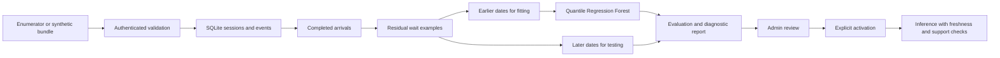

The Python backend uses FastAPI, SQLite, scikit-learn-compatible preprocessing, `quantile-forest`, and trusted local joblib artifacts. Docker runs one API worker under supervisord. That single-worker setting is intentional: the training lock, browser sessions, and active in-memory model live in one process.

The database and runtime artifacts persist in named Docker volumes. Candidate training leaves the active model unchanged. Explicit activation writes the active artifact through atomic file replacement and updates the in-memory reference. On restart, the active model is restored. Browser sessions expire, while the administrator password remains in the runtime volume.

The root Dockerfile is the full build path. This validation used the source-only cached-image build because the registry download stalled. `deploy/Dockerfile.cached` reuses previously installed dependencies and overlays project source and the reference catalog. It is appropriate only while the dependency lock remains unchanged; it is not evidence that a fresh network build completed on the validation date.

## 7. Dataset and provenance

### 7.1 Real places and simulated observations

| Item | What is real | What is simulated or unverified |
|---|---|---|
| Kencom | An existing CBD bus-stage location, documented in transport sources | Arrival times, headways, and the study service |
| Odeon | An existing CBD bus-stage location, documented in transport sources | Arrival times, headways, and the study service |
| Railways | The Nairobi Central Station area, documented by Kenya Railways | Exact boarding point and matatu arrival process |
| Study route | A catalog identifier for a teaching experiment | Connectivity and operation of `cbd-study-simulated` |
| Direction | A required API value | `townbound` is a simulation convention here, not verified CBD operating direction |

Kencom and Odeon are identified in the ITDP transport study, and Kenya Railways identifies Nairobi Central Station and its CBD context. These sources substantiate place names; they do not substantiate this dataset's timestamps or a current service connecting all three places. [6, 7]

No suitable field arrival log was obtained for this run. Public maps, static schedules, and older transport reports are useful context but do not replace timestamped ground truth at the selected stage, route, and direction.

### 7.2 Reproducible generator

The project-owned dataset is `nairobi-cbd-synthetic-v1`. Its generator uses seed **20261027** and produces two 90-minute sessions per stage per day, beginning at 07:00 and 12:00 Nairobi time, over 5–18 October 2026.

For demonstration only, the base headways are 4.5, 6.0, and 8.0 minutes for Kencom, Odeon, and Railways respectively. Midday multiplies the base by 1.55, and weekends multiply it by 1.2. These values are teaching assumptions, not empirical findings.

The next headway is generated approximately as:

```text
regime = stage_base * time_multiplier * day_multiplier
h_next = clip(0.35*h_previous + 0.65*regime + Normal(0, 1.2), 2, 22)
```

Timestamps are rounded to seconds. The construction deliberately contains learnable context and persistence, so good performance establishes recovery of simulated structure. It is an easier and more controlled setting than unknown real matatu operations.

The bundle stores metadata, completed sessions, and observations. Sessions declare `data_kind="synthetic"` and a dataset identifier. The importer verifies those declarations match metadata, validates catalog scope, timestamps, session duration, IDs and conflicts, then commits the bundle atomically. Declared provenance and hashes improve traceability; neither proves that a person actually observed a vehicle.

### 7.3 Data inventory

| Quantity | Value |
|---|---:|
| Real place labels | 3 |
| Simulated study routes / directions | 1 / 1 |
| Observation dates | 14 |
| Completed sessions | 84 |
| Session duration | 90 minutes |
| Total synthetic enumerator-equivalent coverage | 126 stage-hours |
| Arrival observations | 1,049 |
| Training sessions / held-out sessions | 66 / 18 |
| Training query examples / held-out query examples | 4,684 / 1,259 |
| Held-out queries excluded for unsupported groups | 0 |

The 126 stage-hours are simulated coverage, not actual enumerator work. They exceed the original proposal's fieldwork target to provide a usable teaching dataset.

## 8. Validation protocol

The final three complete dates were held out: **16, 17, and 18 October 2026**. The main model fitted earlier dates **5–15 October**. Date boundaries are calculated in `Africa/Nairobi`, rather than treating UTC midnight as Nairobi midnight.

The vectorizer and forest fit only the training partition. The evaluated model is not subsequently refitted on the held-out examples before activation. This preserves the identity between evaluated and activated artifacts. Randomly splitting neighbouring minute queries would allow closely related observations from an interval to appear on both sides; chronological date separation is more defensible for this task. [8, 9]

Fixed hyperparameters were used: 100 trees, minimum leaf size 5, all leaf targets retained, all encoded features eligible at each split, and random seed 42. No hyperparameter search or model selection based on this holdout was conducted. The report records configuration, package versions, data hash, dates, sample counts, model version, group results, daily results, pinball loss, diagnostic controls, and learning curves.

The minimum supported group contains 30 training query examples across at least three training dates. This is a software threshold, not a statistically justified sample-size recommendation for deployment.

### Admin actions actually performed

1. Signed into the local admin panel.
2. Selected the versioned dataset file using the dataset-import form.
3. Validated and imported 1,049 observations with 84 completed sessions.
4. Selected **3 held-out days** and initiated training from the panel.
5. Reviewed the candidate comparison and learning-curve results.
6. Activated the reviewed synthetic candidate.
7. Recomputed metrics independently from exported held-out predictions.
8. Checked that historical observations do not generate a misleading live estimate.

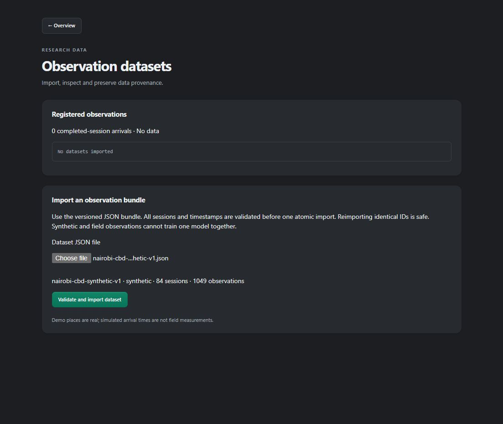

*Figure 1. Dataset selection identifies synthetic provenance before import.*

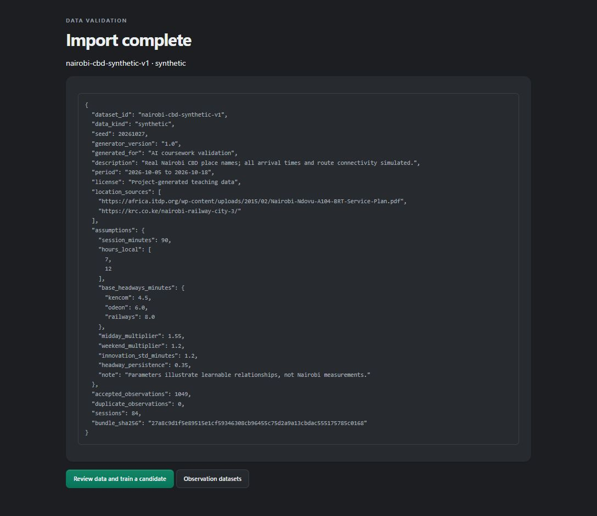

*Figure 2. Import audit with counts, declared assumptions, and a source-bundle hash.*

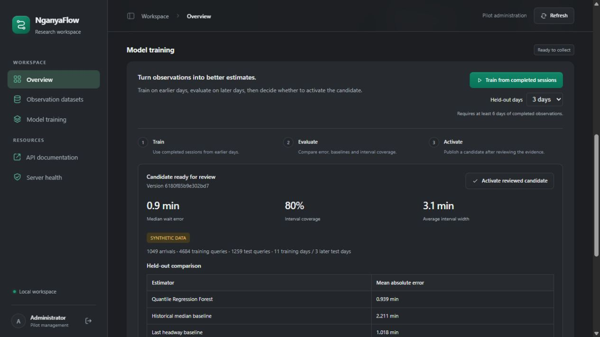

*Figure 3. The three-day holdout setting is retained after training and a server restart; it matches the recorded split in the candidate report.*

## 9. Metrics and measured results

### 9.1 Metric definitions

For target `y_i`, median prediction `m_i`, lower bound `l_i`, and upper bound `u_i`:

```text
MAE = mean(abs(y_i - m_i))
empirical_coverage = mean(indicator(l_i <= y_i <= u_i))
mean_interval_width = mean(u_i - l_i)
pinball_tau(y, q) = tau*(y-q) if y >= q, else (1-tau)*(q-y)
```

MAE measures typical absolute median error in minutes. Coverage measures how often the target falls within the returned interval. Width checks whether coverage was obtained with unhelpfully broad intervals. Pinball loss evaluates each quantile with asymmetric penalties; smaller values are better. [10]

### 9.2 Main comparison

| Estimator or control | Held-out MAE in minutes | Meaning |
|---|---:|---|
| Quantile Regression Forest median | **0.938715** | Fitted context-dependent model |
| Historical median residual wait | 2.210988 | Training-group median of query labels |
| Last headway minus elapsed time | 1.017938 | Recent-interval heuristic, clipped at zero |
| Forest with shuffled training labels | 2.409346 | Negative control preserving the marginal label distribution |

The forest reduced MAE by approximately **57.54%** relative to the historical-median baseline and **7.78%** relative to the stronger last-headway baseline. These are descriptive point estimates on the same synthetic holdout, not statistically established field improvements.

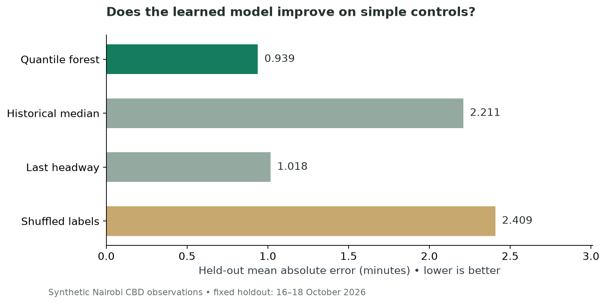

*Figure 4. Recomputed holdout comparison from the persisted evaluation artifacts.*

### 9.3 Quantile performance

| Measure | Observed value |
|---|---:|
| Nominal interval coverage | 80.00% |
| Empirical interval coverage | 80.0635% |
| Mean interval width | 3.10146 minutes |
| Pinball loss at 0.10 | 0.185645 |
| Pinball loss at 0.50 | 0.469357 |
| Pinball loss at 0.90 | 0.224566 |

The pooled coverage is close to its target, but that does not establish conditional calibration. Kencom and Odeon have lower coverage than Railways. A presentation should show that variation rather than relying only on the pooled 80% figure.

| Place label | Held-out queries | MAE in minutes | Empirical coverage |
|---|---:|---:|---:|
| Kencom | 439 | 0.8734 | 76.99% |
| Odeon | 424 | 0.8813 | 78.07% |
| Railways | 396 | 1.0725 | 85.61% |

Daily MAE was 0.9154 minutes on 16 October, 0.9827 on 17 October, and 0.9179 on 18 October. There are only three test dates; a strong claim about day-to-day robustness would require substantially more independent observation periods.

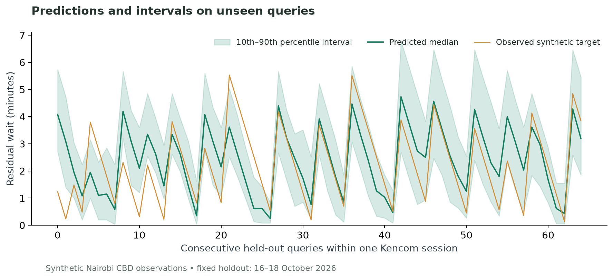

*Figure 5. Consecutive held-out queries in a single simulated Kencom session. The sawtooth targets reflect residual time decreasing until each next arrival.*

## 10. Evidence of learning and model reliance

### 10.1 Shuffled-label control

The control forest uses the same training feature matrix, model family, hyperparameters, and random seed, but randomly permutes training labels. Its MAE rises from 0.9387 to 2.4093 minutes. This supports the interpretation that useful feature-label relationships contribute to the fitted model's predictions, rather than the panel merely displaying a fixed wait value.

One shuffled training run is a diagnostic control. It is not a formal permutation significance test, which would require repeated refitting under a specified null hypothesis and appropriate dependence handling. It also cannot prove authenticity of real-world data.

### 10.2 Learning curve

| Earlier training days | Training queries | Training MAE | Fixed-holdout MAE |
|---:|---:|---:|---:|
| 3 | 1,280 | 0.6276 | 1.1363 |
| 5 | 2,138 | 0.6389 | 1.0163 |
| 11 | 4,684 | 0.6361 | 0.9387 |

The final model's held-out error is about 17.39% lower than the three-day model's error. Training error remains below held-out error, as expected for a fitted model. The narrowing gap is useful evidence of improved generalisation within the simulation, not proof that performance must improve monotonically on real data.

All curve points use the same three test dates. They are descriptive diagnostics, not additional independent tests. Increasing the training period also changes the mix of weekdays and regimes. The curve therefore reflects both additional data and broader context coverage.

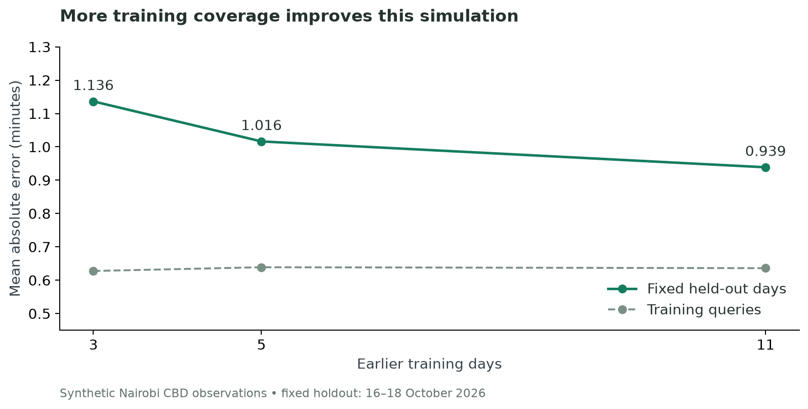

*Figure 6. Training and held-out errors for the three recorded training horizons.*

### 10.3 Permutation importance

Held-out feature importance is measured by permuting one conceptual feature at a time, jointly moving all its one-hot columns, and observing the change in median MAE. Three repeat permutations are used. This evaluates reliance of the fitted model, rather than a causal effect of the feature. Correlated inputs and unrealistic combinations created by permutation limit interpretation. [11]

Elapsed time increased MAE by about **1.816 minutes** when permuted, and previous headway by **1.726 minutes**. Stage and hour had smaller positive effects. Route and direction had zero measured importance because they are constant in this dataset. Weekday's near-zero negative value is consistent with noise and redundancy; it is not evidence that weekdays have no effect on actual Nairobi services.

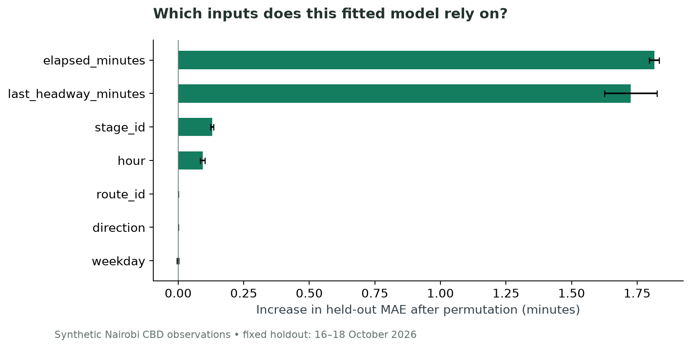

*Figure 7. Mean MAE increase and standard deviation across three repeat permutations. Error bars are not confidence intervals.*

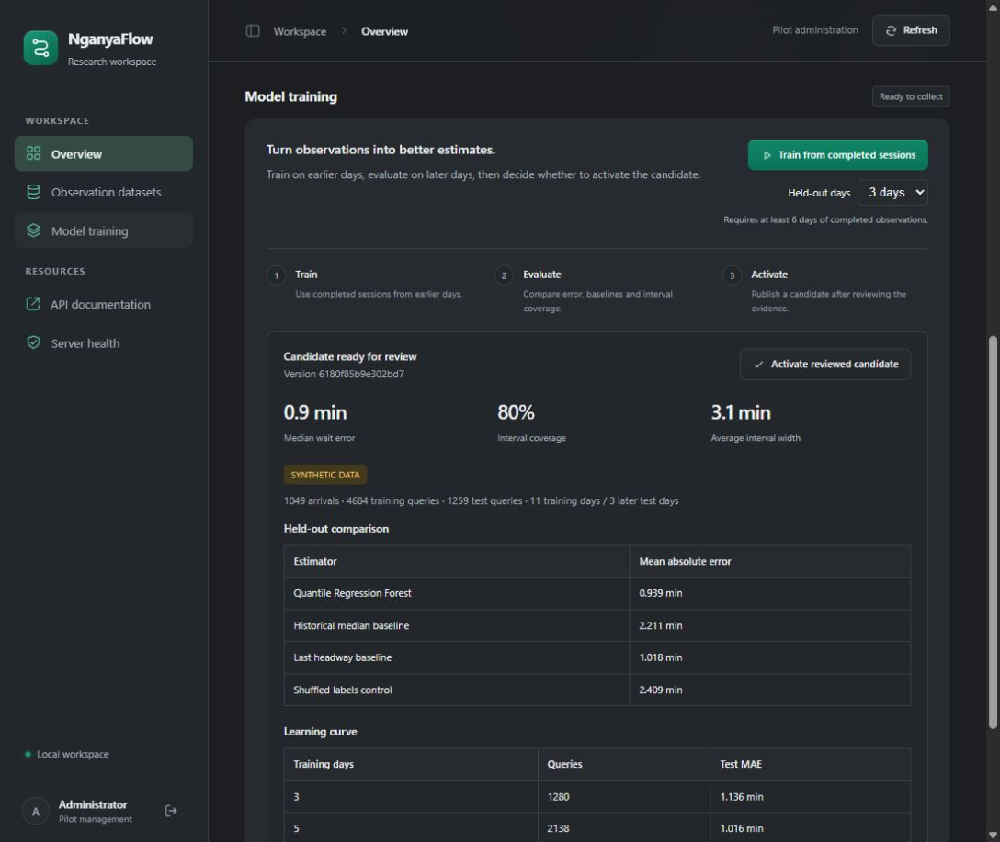

*Figure 8. The panel shows the candidate's actual held-out comparison with synthetic provenance.*

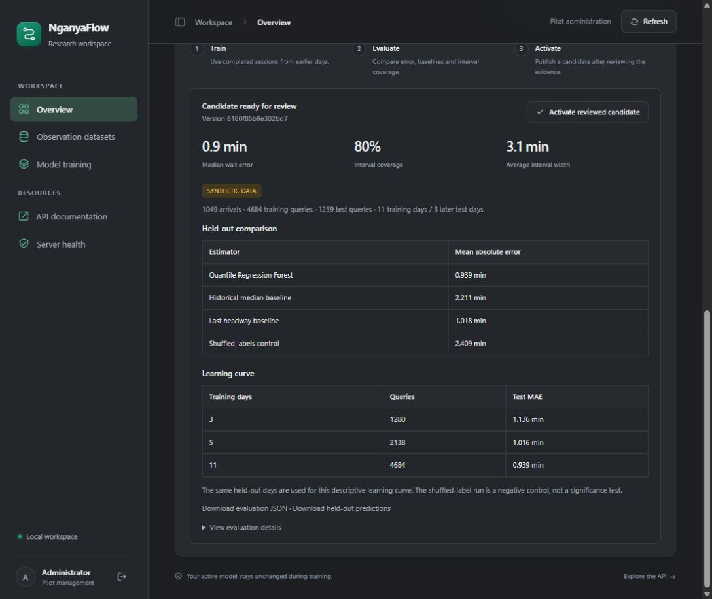

*Figure 9. The admin panel displays the training-day learning curve and links to machine-readable results.*

## 11. Analysis checks and software validation

**20 automated tests passed**, with Ruff checks passing. The test output includes one upstream Starlette/httpx deprecation warning; it did not fail the checks. The source-only Docker image reported no broken installed Python requirements.

| Check | Result or interpretation |
|---|---|
| Authentication and CSRF | Protected writes reject missing credentials or invalid tokens |
| Offline retries | Identical event IDs return duplicate acknowledgements rather than creating extra rows |
| Conflicting reuse | Conflicting IDs or timestamps are rejected |
| Transaction rollback | A conflicting imported bundle does not leave its new sessions partially stored |
| Timestamp checks | Naive, future, and out-of-session timestamps are rejected |
| Session closure | Closed-session exports exclude open sessions |
| Provenance | Metadata/session mismatch is rejected; mixed field/synthetic training is rejected |
| Temporal separation | Training and test dates are disjoint and strictly ordered |
| Label boundaries | Tests cover duplicate arrivals and midnight separation |
| Holdout controls | Invalid holdout-day values cannot start training |
| Reproducible data | Generator returns the same logical dataset for its fixed seed |
| Metrics integrity | MAE and interval coverage were recomputed independently from 1,259 exported predictions |
| Quantile order | Every exported lower bound is at most its median, which is at most its upper bound |
| Activation | The reviewed model artifact exists as the persisted active artifact |
| Stale information | Live Kencom query correctly returns `unavailable` with `stale_evidence` |

The live query is expected to abstain because the latest simulated arrivals are from 18 October and validation took place on 27 October. Activating a historical model does not make historical observations current. The system correctly avoids showing those observations as a live Nairobi estimate.

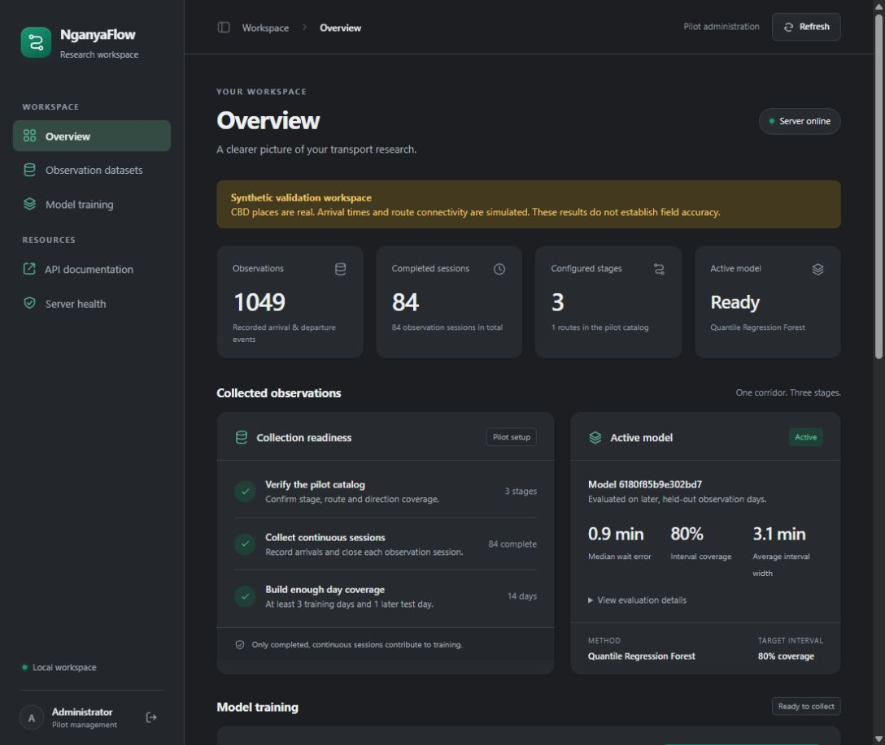

*Figure 10. The reviewed synthetic model was explicitly activated. Screenshots are browser viewport captures with no pointer cursor overlaid; none contain the administrator password.*

## 12. Limitations and next research decisions

1. **Simulation transfer:** the generator supplies stage, time, and persistence patterns intentionally. Real data may contain bunching, missing vehicles, route misidentification, demand-triggered departures, disruptions, and selection bias absent here.
2. **Small independent holdout:** 18 sessions over three dates provide many correlated query labels, not a large independent sample. There is no formal significance test or credible field uncertainty interval for the MAE improvement.
3. **Censoring and coverage:** final session tails and very long gaps are omitted. This can underrepresent long waits. A field protocol should observe beyond the evaluation query window and examine sensitivity to gap thresholds.
4. **Calibration:** pooled 80% coverage masks stage variation. Before deployment, reserve calibration data or assess a justified interval-calibration method on a separate period.
5. **Generalisability:** one simulated route and one direction cannot validate route- or direction-specific learning. The forest abstains for unsupported groups, weekdays, hours, elapsed times, and headways.
6. **Observation integrity:** server validation checks format and consistency, not whether an enumerator actually saw a vehicle. Audit collection methods, prevent overlapping duplicate observations, and maintain collection records.
7. **Deployment security:** the shared writer token is a local pilot mechanism. Public deployment needs per-user roles, TLS, controlled credential handling, retention rules, backups, and rate limiting. Password logging remains the user-requested local bootstrap behaviour.
8. **Model selection:** repeated inspection and tuning against these same three test dates would turn the holdout into a development set. Reserve another untouched period for a later final claim.

The next field study should define verified boarding sides and route/direction identities, document continuous observation and pause handling, cover peak/off-peak and weekday/weekend periods, and compare the same baselines without discarding an unfavourable result. The original 40–60 enumerator-hour proposal is a planning target, not evidence that data has been collected. Missingness and reporting-rate degradation should be evaluated before claiming usefulness from sparse commuter pings.

## 13. Mobile Application Development alignment

The Android client remains future implementation. The working screenshots in this report are of the server admin panel, not a completed Android application. The Figma prototype informs workflow intent, while the backend supplies integration contracts.

| Mobile-unit concern | Current backend contribution | Remaining mobile work |
|---|---|---|
| Stage and route selection | Catalog endpoints and joint scope validation | Android lists, search, selected-stage state and navigation |
| Networking | Documented FastAPI JSON endpoints and error status codes | Repository/service layer, request lifecycle and UI error recovery |
| Offline operation | Client-generated IDs and idempotent sync acknowledgements | Room or equivalent local queue, connectivity-aware retry and queue visibility |
| Data capture | Sessions, arrival/departure events, occupancy enums, timezone validation | Enumerator screens, pause/end handling, validation feedback |
| Estimates | Median, bounds, evidence timestamps, expiry, unavailable reasons and provenance | Range presentation, stale-cache suppression and synthetic-data indication |
| Security and privacy | Local pilot access control; no location or identity required by this slice | Per-user authentication, consent, permissions, retention/deletion and secure token storage |
| Accessibility | Explicit states and clear error meanings | Screen-reader labels, font scaling, touch targets and reviewed translations |
| Testing | Backend and model-pipeline tests | Android unit, integration, UI, offline and device tests |

The intended mobile sequence is: select a verified stage and route; request an estimate; render either a bounded range or an unavailable explanation; capture a contribution locally; queue its UUID; synchronise; remove it from the queue only when the server acknowledges the same ID. Server receipt time must not replace the original observation timestamp during offline recovery.

Client code should treat `data_kind="synthetic"` as a demonstration indicator when predictions are available. When an estimate is unavailable, the client should explain its `reason` and avoid reusing a cached number after `expires_at`. A mobile screen displaying precise unsupported waits would undermine the AI study even if the regression code is correct.

## 14. Reproduction and operator guide

Run commands from the repository root unless stated otherwise. The example bundle is intentionally versioned teaching data; raw field observations, runtime credentials and model files remain ignored by Git.

### Generate the same logical teaching dataset

```powershell
.venv/Scripts/python -m nganyaflow.synthetic --output server/data/examples/nairobi-cbd-synthetic-v1.json --catalog server/data/reference/catalog.json
```

This command writes the teaching catalog as well as the bundle. Use a separate verified catalog for a field pilot. Newline encoding can change the raw JSON file hash across platforms; the logical data generation is deterministic. The evaluated run's exact bundle is included with the evidence package.

### Build and run

```bash
bash build-docker.sh
# With the existing local image and unchanged requirements only:
docker build --load -f deploy/Dockerfile.cached -t nganyaflow:ai-validation .
```

Use the named-volume run instructions in `docs/development.md`. Preserve `/app/data/raw`, `/app/runtime`, and `/app/artifacts`. Retrieve the locally generated administrator password with `docker exec nganyaflow cat /app/runtime/admin-password.txt`; do not put it in coursework screenshots or documentation.

### Repeat the admin experiment

1. Open `/admin`, sign in, and choose **Observation datasets**.
2. Select `nairobi-cbd-synthetic-v1.json`, inspect its synthetic provenance and counts, and choose **Validate and import dataset**.
3. Identical reimports acknowledge duplicates rather than adding arrivals. A conflicting bundle fails atomically.
4. Return to **Model training**, select **3 days** in **Held-out days**, then choose **Train from completed sessions**.
5. Refresh after completion. Confirm 11 training dates, 3 later test dates, and the dataset/model identifiers.
6. Review baselines, interval coverage, the learning curve and limitations. Download evaluation JSON and held-out predictions before training another candidate.
7. Choose **Activate reviewed candidate** for this synthetic teaching workspace only. It does not constitute approval for real commuter deployment.

### Command line equivalent and automated checks

```powershell
.venv/Scripts/nganyaflow export --output server/data/processed/arrivals.csv
.venv/Scripts/nganyaflow train --input server/data/processed/arrivals.csv --output server/artifacts/wait-study.joblib --test-days 3
.venv/Scripts/python -m pytest server/tests -q
.venv/Scripts/ruff check server
```

The CLI provides an equivalent pipeline, but it was not used as a substitute for the recorded admin-panel training action. Exact floating-point values may vary across package versions or platforms; compare recorded versions and artifacts before attributing a difference to learning.

## 15. Evidence manifest and reproducibility record

| Item | Recorded value or location |
|---|---|
| Dataset ID | `nairobi-cbd-synthetic-v1` |
| Generator seed | `20261027` |
| Source bundle SHA256 | `27a8c9d1f5e89515e1cf59346308cb96455c75d2a9a13cbdac555175785c0168` |
| Validated arrival-row JSON SHA256 | `2821ffeff5233536357939ef53fb66bacb58faa73d93cba312996bc7a44c58d4` |
| Model version | `6180f85b9e302bd7` |
| Python in validation container | `3.12.15` |
| quantile-forest | `1.4.2` |
| scikit-learn | `1.9.1` |
| NumPy | `2.5.4` |
| Evaluation | [evaluation.json](evidence/evaluation.json) |
| Query predictions | [held-out-predictions.csv](evidence/held-out-predictions.csv) |
| Verification record | [verification.json](evidence/verification.json) |
| File checksums | [SHA256SUMS.txt](evidence/SHA256SUMS.txt) |

The bundle-file hash covers the original JSON bytes. The arrival-row hash covers the ordered, serialised completed-arrival records exported from validated storage, before the temporal split; it includes the input records for both fitting and evaluation and is expected to differ from the bundle hash. The model version hashes those arrival inputs and the recorded core training configuration. The hash itself is an identifier and is not used as a model feature. These identifiers support reproducibility but are not a cryptographic signature of field authenticity.

### Code map

| Module | Responsibility |
|---|---|
| `server/src/nganyaflow/synthetic.py` | Deterministic teaching generator and catalog |
| `datasets.py` | Portable bundle validation and provenance checks |
| `schemas.py` | Typed sessions, observations, and estimate contracts |
| `storage.py` | SQLite persistence, idempotency and atomic imports |
| `ml.py` | Label construction, training, diagnostics and prediction export |
| `admin.py` | Protected import, training, review, activation and downloads |
| `admin_ui.py` | Server-rendered administration views |
| `main.py` | API routes, inference inputs, expiry and abstention |
| `cli.py` | Export and reproducible training commands |
| `server/tests/` | Backend and research regression checks |

Changes remain in the local working tree at the time of this report. A reviewed commit should be made before an assessed handover or publication, so the report can refer to an immutable revision.

## References

1. Russell, S. and Norvig, P. *Artificial Intelligence A Modern Approach*, fourth edition, contents and subject map. [Publisher-author companion site](https://aima.cs.berkeley.edu/contents.html).
2. scikit-learn. *Decision Trees*. [Official documentation](https://scikit-learn.org/stable/modules/tree.html).
3. scikit-learn. *Ensembles and random forests*. [Official documentation](https://scikit-learn.org/stable/modules/ensemble.html).
4. Meinshausen, N. (2006). *Quantile Regression Forests*. JMLR 7(35), 983–999. [Paper](https://www.jmlr.org/papers/v7/meinshausen06a.html).
5. Zillow. *RandomForestQuantileRegressor*. [Versioned API documentation](https://zillow.github.io/quantile-forest/generated/quantile_forest.RandomForestQuantileRegressor.html).
6. ITDP (2015). *Nairobi Ndovu A104 BRT Service Plan*. Used to substantiate existing transport-location names, not to generate current arrival observations. [Report](https://africa.itdp.org/wp-content/uploads/2015/02/Nairobi-Ndovu-A104-BRT-Service-Plan.pdf).
7. Kenya Railways. *Nairobi Railway City*. Used to substantiate Nairobi Central Station and its CBD context. [Project page](https://krc.co.ke/nairobi-railway-city-3/).
8. scikit-learn. *Cross-validation and time-dependent data*. [Official documentation](https://scikit-learn.org/stable/modules/cross_validation.html).
9. scikit-learn. *Common pitfalls and recommended practices*. [Official documentation](https://scikit-learn.org/stable/common_pitfalls.html).
10. scikit-learn. *Mean pinball loss*. [Official API documentation](https://scikit-learn.org/stable/modules/generated/sklearn.metrics.mean_pinball_loss.html).
11. scikit-learn. *Permutation feature importance*. [Official documentation](https://scikit-learn.org/stable/modules/permutation_importance.html).

Web references were consulted on 27 October 2026. Project-specific measurements come from the linked persisted experiment artifacts, not from the literature. The original concept presentation supplies the focused QRF pilot scope; the broader systems-concepts PDF supplies possible future research directions. Neither is treated as proof that those additional AI components are implemented.
