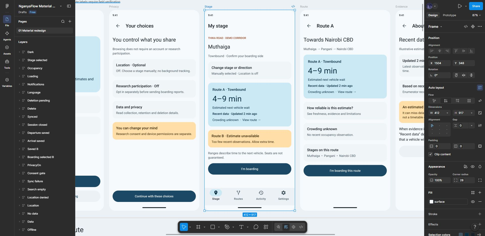

# Material 3 design specification

[Editable Figma file](https://www.figma.com/design/8gGZPr44bkjNq1zWNM4YYH?node-id=5-705) · [screen inventory](../design/screens.json) · [tokens](../design/tokens.json)

The redesign contains 41 screen/state frames, reusable native Figma components, Material button/navigation instances, semantic variables, nine Roboto text styles and rider/enumerator/crew prototype starting points. The source design remains available as a comparison. Values, stages, routes and research outcomes in the mockups are illustrative.

## Decisions and reasons

| Finding | Redesign decision |
| --- | --- |
| Location and research choices appeared coupled | Separate optional research consent from just-in-time OS location permission; retain manual browsing |
| A numeric wait could imply certainty | Show a range, next-vehicle definition, observation age and evidence explanation; explicitly say seats are not guaranteed |
| Sparse or stale information could look current | Distinct insufficient-data and offline states; suppress expired numbers |
| Boarding could imply a preselected route | Explicit route choice and confirmation before local save |
| A short undo toast could be missed | Persistent correction route through Activity |
| Saving and uploading could be confused | Distinguish local saved, queued, synced and failed states |
| Operator activity could be mistaken for total demand | Qualify crew summaries and defer dispatch recommendations |
| Similar actions lacked consistent hierarchy | One prominent filled action per decision; quieter secondary actions; stable four-destination navigation |

## Color and typography

Retain brand blue `#1B4965` as the light primary. Pale blue containers provide hierarchy without painting every card a saturated color. Reserve warm amber for evidence warnings, red for errors and green for successful saves; always pair color with words or an icon. The dark palette uses `#10181D` surfaces and `#9ACCEB` primary. Separate Figma light/dark collections accommodate the current plan's variable-mode limits; one dark Stage frame demonstrates the mapping.

| Role pair | Light contrast | Dark contrast |
| --- | ---: | ---: |
| onPrimary / primary | 9.60:1 | 7.64:1 |
| onPrimaryContainer / primaryContainer | 11.13:1 | 7.25:1 |
| onSurface / surface | 15.61:1 | 14.35:1 |
| onSurfaceVariant / surfaceContainerLow | 6.93:1 | 9.70:1 |
| onWarningContainer / warningContainer | 10.67:1 | 9.33:1 |

These are computed sRGB contrast ratios for opaque token pairs; see [all checked pairs](../design/contrast-check.json). They are not a whole-app accessibility certification. Runtime dynamic color, opacity, disabled states and overlays need separate checks.

Roboto body text uses 16/24 or 14/20 size/line height, with 22/28 titles and 36/44 wait values. The token JSON lists all styles. Map font sizes to `sp`, spacing to `dp`, and roles to `MaterialTheme.colorScheme`; keep additional warning/success roles in an explicit status-color extension. Do not hard-code Figma pixels into Android layout.

## Components and flow

Use Material 3 top app bars, navigation bars, buttons, lists, dialogs and progress indicators. The Figma custom components cover route estimates, notices and list rows. Navigation destinations are Stage, Routes, Activity and Settings. Research tools live behind role access rather than becoming additional rider destinations.

Use a 4 dp spacing base, 16 dp content edges and consistent 8/12/16/24 dp gaps. The 412-wide mockups describe a compact layout, not a fixed device requirement. Android must adapt to smaller widths, landscape, large fonts, IME and system insets. Keep the primary action reachable without covering content; scroll content above persistent navigation. Imported button labels use auto width to prevent vertical letter wrapping.

## Accessibility and implementation checks

- At least 48 dp interactive targets, including visually small icons; preserve enough spacing between adjacent targets.
- TalkBack labels for icon actions; decorative icons have no duplicate description. Announce queued/saved/error status meaningfully.
- Preserve reading and focus order, headings, selected states and error associations in Compose semantics.
- Support 200% font scaling without clipping essential information or hiding actions. Test 320/360/412 dp widths and landscape.
- Never rely on color alone. Plain-language evidence labels must not be presented as calibrated confidence percentages.
- Respect system reduced-motion preferences where applicable; transitions must not be required to understand a result.
- Translate and review English/Kiswahili copy with speakers before presenting the language option as implemented.

## Verification and limitations

Native frames and prototype reactions were created in Figma. The label-sizing problem in imported buttons was repaired through Figma's editor; the rider screens were visually checked afterward. Nested dark-frame colors were rebound to the dark semantic variables and the resulting Stage screen was visually checked; see the [dark review](../design/dark-review.png). Representative recovery/research screens are review aids. The starter-plan API allowance prevented a complete automated post-edit audit of every frame.

This is a design prototype. Forms, selection memory, research consent persistence, permissions, login, syncing, model inference and deletion are not implemented services. Screen transitions demonstrate intended decisions, with illustrative counts and confirmations. Do not mark the Android accessibility, performance or offline acceptance checks as passed until a runnable app exists. See [product state contracts](product.md) for additional implementation-only failure cases.
